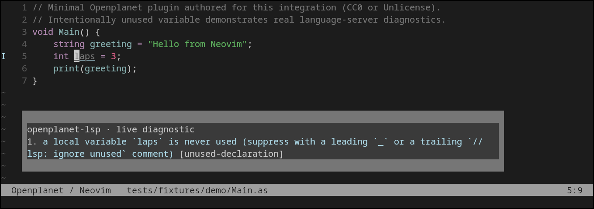

# Openplanet for Neovim

AngelScript filetypes, syntax, and [Openplanet language server](https://github.com/clankercode/lsp-openplanet) integration for Neovim. Includes completion, hover, diagnostics, and attachment to plugin `info.toml` manifests without changing their TOML filetype.



Actual Neovim 0.12.6 running the published server 0.8.0 in kitty/Xvfb. The diagnostic comes from the server; the screenshot is not a mockup. [Reproduce it](docs/verification.md).

## Install

Requires Neovim **0.11+** (recommended), or **0.10 with nvim-lspconfig v1.8.0**. First install the server explicitly using the same npm package used for other Openplanet editors:

```sh
npm install -g openplanet-lsp
openplanet-lsp --version
```

Alternatively use `cargo install openplanet-lsp` or a [platform release archive](https://github.com/clankercode/lsp-openplanet/releases). Ensure `openplanet-lsp` is on the PATH seen by Neovim. There is no runtime downloader or automatic install.

With lazy.nvim:

```lua
{
  "clankercode/lsp-openplanet-neovim",
  lazy = false,
  opts = {},
  main = "openplanet",
}
```

Or install with Neovim's native packages:

```sh
git clone https://github.com/clankercode/lsp-openplanet-neovim \
  ~/.local/share/nvim/site/pack/openplanet/start/lsp-openplanet-neovim
```

Then in `init.lua`:

```lua
require("openplanet").setup()
```

On 0.10 install `neovim/nvim-lspconfig` at tag `v1.8.0` too, and load it before setup. Newer nvim-lspconfig versions may require newer Neovim.

## Configure

```lua
require("openplanet").setup({
  -- Optional: authoritative override, including paths with spaces.
  server_path = "/absolute/path/to/openplanet-lsp",
  -- Optional: only send settings you explicitly want to override.
  init_options = {
    game_target = "TMNEXT",
    -- openplanet_dir = "/path/to/OpenplanetNext",
    -- plugins_dir = "/path/to/OpenplanetNext/Plugins",
    -- defines = { "MY_DEFINE" },
  },
  on_attach = function(client, bufnr)
    vim.keymap.set("n", "K", vim.lsp.buf.hover, { buffer = bufnr })
    vim.keymap.set("n", "<leader>e", vim.diagnostic.open_float, { buffer = bufnr })
  end,
  -- capabilities = require("cmp_nvim_lsp").default_capabilities(),
})
```

`server_path`, `init_options`, `on_attach`, `capabilities`, and `settings` are supported. A bad explicit binary fails visibly; it never falls back to PATH. Without an override the command is `openplanet-lsp --lsp`. The `--lsp` argument is required for stdio operation. Initialization options default to `{}`, so the server can honor `.openplanet-lsp.toml`, parent workspace configuration, user configuration, and Openplanet auto-detection. Use the server's **snake_case** keys. No fixture type database is installed or enabled.

For native configuration on 0.11+, skip `setup()` and use:

```lua
vim.lsp.config("openplanet", require("openplanet").config({}))
vim.lsp.enable("openplanet")
```

The shipped `lsp/openplanet.lua` also lets `vim.lsp.enable("openplanet")` work on its own when the server is on PATH. Choose one setup method. Most users should call `setup()`, which also checks that the executable exists.

## Editing

All `.as` files become `angelscript`, overriding Neovim's built-in Atlas association. The included syntax builds on Neovim's C syntax and adds AngelScript keywords and handles. `info.toml` keeps TOML highlighting and may have both this server and a TOML server attached. Other TOML filenames never attach to Openplanet, even inside a plugin directory.

The nearest ancestor containing `info.toml` or `.openplanet-lsp.toml` becomes the root. A nearer plugin wins over a parent workspace marker. Standalone `.as` files fall back to their containing directory. Multiple plugin roots get separate clients. Openplanet includes remain server-managed; this plugin does not rewrite `#include` paths.

Neovim's `K`, `vim.lsp.buf.hover()`, `vim.lsp.buf.definition()`, and diagnostic APIs use the attached server. Use insert mode `Ctrl-X Ctrl-O` for built-in omnifunc completion, or configure your normal completion plugin with the supplied `capabilities` option. On 0.11+ you can enable native automatic completion in `on_attach`:

```lua
vim.lsp.completion.enable(true, client.id, bufnr, { autotrigger = true })
```

Server capabilities and installed Openplanet type data determine results. See the precise [verification limits](docs/verification.md), including an empty definition result in the local test.

## Troubleshooting

- **No server:** check `:lua print(vim.fn.exepath("openplanet-lsp"))`, then restart Neovim after installing. Shell and GUI PATH can differ; use `server_path`.
- **Wrong filetype:** run `:set filetype?`; load this plugin before opening `.as` files. The plugin intentionally associates all `.as` files with AngelScript.
- **No attachment:** inspect `:checkhealth vim.lsp`, `:lua vim.print(vim.lsp.get_clients({bufnr=0}))`, and `:LspLog`. On 0.10, `:LspInfo` is available through nvim-lspconfig.
- **Missing game API symbols:** configure your real Openplanet installation or type databases through the server configuration. A standalone file cannot provide APIs that are absent from that installation.
- **Other TOML files:** only the exact name `info.toml` is eligible by design.

## Development and licensing

Run `bash scripts/test.sh` for lightweight configuration checks, and `nvim --headless -u NONE -l tests/live.lua` with the server installed for real editor verification. [Verification](docs/verification.md) records commands, versions, screenshots and limits. [Publishing](docs/publishing.md) explains public distribution and registry status.

SPDX: **Unlicense OR CC0-1.0**. Choose either the full [Unlicense](UNLICENSE) or [CC0 1.0](LICENSE-CC0). Demo sources, scripts, documentation and screenshot are included under the same choice. Neovim's built-in C syntax is loaded from the user's own installation, not copied into this repository.
